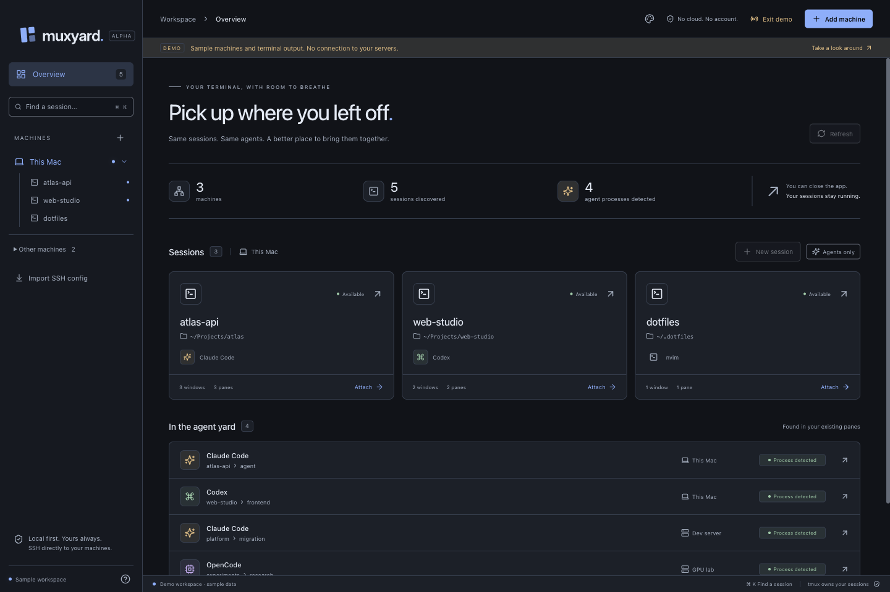
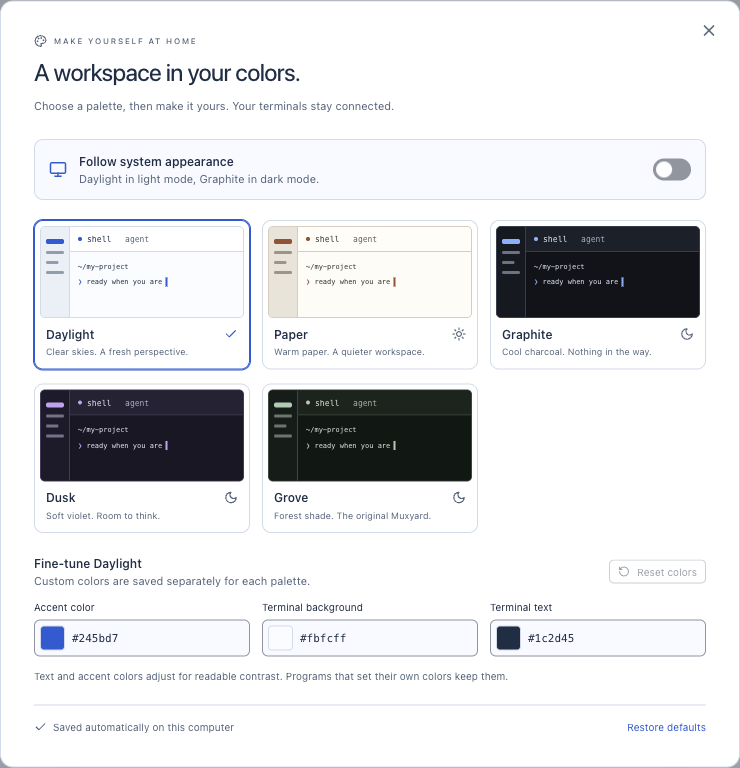

<p align="center">
  <picture>
    <source media="(prefers-color-scheme: dark)" srcset="assets/brand/wordmark-dark.svg" />
    
  </picture>
</p>

<h1 align="center">Your tmux. A better view.</h1>

<p align="center">A desktop GUI for the tmux sessions and coding agents you already run.<br />Local or over SSH. No account, cloud relay, or remote daemon.</p>

<p align="center"><a href="https://xiaoguang.wang/muxyard/">Website</a> · <a href="https://github.com/xjtuwxg/muxyard/releases">Download preview</a> · <a href="#quick-start">Quick start</a> · <a href="docs/architecture.md">Architecture</a></p>

<p align="center"><a href="https://github.com/xjtuwxg/muxyard/actions/workflows/ci.yml"></a></p>



_Current source preview with labeled demo data. Published v0.1.0 installers use the original appearance; customizable themes, the unified logo, and the latest pane fitting improvements are available in source and will ship in the next preview._

## Keep the sessions. Lose the window hunting.

- **Attach what already exists.** Discover tmux sessions on your computer or an SSH machine. No migration and no extra Muxyard service on the server.
- **Click into the work.** Switch windows and panes with the mouse. Create sessions, add windows with Ctrl+T, split panes, and zoom without memorizing every tmux prefix.
- **Give terminals the space.** Collapse the management panels or enter focus mode. Compact window tabs keep navigation within reach.
- **Find your coding tools.** Detect Claude Code, Codex, OpenCode, Gemini, and Aider when tmux reports their executable names. Interact in the real terminal.
- **Make it yours.** Five light/dark palettes, system appearance, and per-palette accent and terminal color customization. Changes preserve live connections and scrollback.
- **Close the app and come back.** Muxyard releases its own clients. Tmux keeps responsibility for sessions and process lifetime.

## Download the preview

Choose your operating system and processor on the [website](https://xiaoguang.wang/muxyard/#downloads), or get installers and `SHA256SUMS` from [GitHub Releases](https://github.com/xjtuwxg/muxyard/releases).

| Platform            | Packages      | What to know                                               |
| ------------------- | ------------- | ---------------------------------------------------------- |
| macOS Apple Silicon | DMG, ZIP      | Ad-hoc signed preview; not notarized                       |
| macOS Intel         | DMG, ZIP      | Ad-hoc signed preview; not notarized                       |
| Windows x64         | EXE installer | Unsigned preview; remote tmux over system OpenSSH          |
| Linux x64           | AppImage, DEB | Built on Ubuntu 24.04; other distributions need validation |

Install tmux for local sessions on macOS/Linux. Remote machines need SSH and tmux, with working key authentication. Windows does not include local tmux or WSL integration. Mac and Windows previews can trigger OS trust warnings. Automatic updates are not implemented.

## Quick start

For a source build on macOS, install Node.js 22.12+ (or a newer supported release), npm, Xcode Command Line Tools, and tmux:

```sh
brew install tmux
npm ci
npm run dev
```

Open **This Mac** and attach an existing session, or click **New session** to create one. Muxyard can start a tmux server when there are no sessions yet. Closing a tab or pressing **Detach** releases only Muxyard's client.

To try the interface without a connection, choose **Explore demo**. All sample machines and output are labeled.

See the [build and release guide](docs/releasing.md) for macOS installers, Windows/Linux source builds, signing, and release workflows.

## Connect to a remote host

Verify your system OpenSSH configuration first:

```sshconfig
Host dev-server
    HostName server.example.com
    User developer
    IdentityFile ~/.ssh/id_ed25519
    AddKeysToAgent yes
    # Optional: Port 2222
    # Optional: ProxyJump bastion
```

```sh
ssh dev-server
# On the server:
tmux ls
exit
# Verify non-interactive access:
ssh -o BatchMode=yes -o StrictHostKeyChecking=yes dev-server tmux -V
```

In Muxyard, choose **Import SSH config**, select the aliases you want, and add them. Nothing is selected or contacted automatically. **Check & select reachable** optionally tests filtered aliases with at most three concurrent attempts. **Add machine** also accepts an SSH alias or `user@hostname` directly.

Manually added and explicitly imported machines stay in **Machines** after restarting, including while offline. Older bulk-imported aliases remain under **Other machines** until you pin or successfully connect to them. Profiles contain labels, destinations, socket names, and grouping preferences; private keys and passwords are not copied into app storage.

OpenSSH handles keys, ports, jump hosts, and full configuration for connections. The import preview reads literal aliases in the main `~/.ssh/config`; it skips wildcard patterns and does not expand `Include` files. Included aliases can still be entered manually. Verify host keys and key authentication in your normal terminal first. Tmux must be on the remote non-interactive shell's `PATH`.

Named tmux sockets are supported with the optional socket-name field (`tmux -L name`). Custom filesystem socket paths (`-S`) are not supported yet.

## A workspace in your colors

Open **Appearance** using the palette button in the overview, attached workspace, or focus toolbar.

| Theme    | Appearance | Character                                  |
| -------- | ---------- | ------------------------------------------ |
| Daylight | Light      | Crisp whites, slate text, and clear blue   |
| Paper    | Light      | Warm ivory, ink text, and terracotta       |
| Graphite | Dark       | Neutral charcoal and cool blue             |
| Dusk     | Dark       | Deep violet and soft lavender              |
| Grove    | Dark       | Forest green, the original Muxyard palette |



System appearance is the default: Daylight for light mode, Graphite for dark mode. Each palette remembers its custom accent, terminal background, and terminal text colors across app restarts. Reset the current palette with **Reset colors**, or clear all preferences with **Restore defaults**.

Text and ANSI colors are adjusted for readability. Programs that send explicit RGB colors or set their own palette keep that behavior. Theme changes do not reconnect clients, clear scrollback, or send commands to remote programs.

## Stay at the keyboard

| Action                            | Shortcut                    |
| --------------------------------- | --------------------------- |
| New tmux window                   | Ctrl+T or Cmd+T             |
| Next / previous window            | Ctrl+Tab / Ctrl+Shift+Tab   |
| Split left/right                  | Cmd+D                       |
| Split top/bottom                  | Cmd+Shift+D                 |
| Toggle focus mode                 | Cmd+Shift+F or Ctrl+Shift+F |
| Toggle machines                   | Cmd+B                       |
| Toggle pane inspector             | Cmd+Shift+B                 |
| Find a session                    | Cmd+K                       |
| Find in terminal / copy selection | Cmd+F / Cmd+C               |

Workspace shortcuts apply to the attached session and are excluded from dialogs and form inputs. Plain Ctrl+D and Escape remain available to terminal applications. Pane view also supports **Ctrl+B c**, **n/p**, **%**, **"**, and **z** for windows, splits, and zoom.

Focus mode keeps clickable window tabs in one compact top strip. Leaving it restores your chosen side panels. Terminal grids resize in place without remounting the connection. Pane scrollbars stay aligned with their available surface; server-constrained tmux dimensions are preserved.

## Behavior to know

- **Shared tmux state stays shared.** Selecting windows or panes can change what another attached client sees. Window sizing still follows your tmux configuration. Muxyard never uses `attach -d` or changes global tmux options.
- **Pane view favors direct navigation.** Each pane has its own terminal surface, output, focus, search, and input routing. Actual tmux splits and external changes are reflected in the GUI. Pop-out native pane windows and drag resizing are not implemented.
- **Classic terminal preserves full tmux behavior.** Use it for custom key tables, tmux overlays, or a TUI that does not render correctly in Pane view. Classic mouse behavior follows your tmux configuration. Hold Shift while dragging to select text when a terminal program uses mouse reporting.
- **Agent discovery is conservative.** Executable names identify tools, not task progress. A wrapper reporting `node` or `python` may not be recognized. Authoritative agent-state hooks are planned.
- **Reconnect deliberately.** After a network failure, use **Reattach**. Successful machines refresh metadata in the background; failures retain a stale snapshot and wait for retry. Automatic sleep/wake recovery remains planned.
- **Tmux controls lifetime.** Settings such as `destroy-unattached` can intentionally end a session after clients leave. Pane view restores up to 1,000 history lines initially; terminal scrollback is capped at 10,000 lines.

## Development

```sh
npm run typecheck
npm test
npm run test:integration
npm run build
npm run test:ui
```

Integration and desktop tests create isolated tmux sockets and application-data directories, and clean up only their own servers. They require tmux, PTY access, and permission to launch Electron. Run desktop tests against a packaged Mac app with:

```sh
MUXYARD_APP="$PWD/release/mac-arm64/Muxyard.app/Contents/MacOS/Muxyard" npm run test:ui
```

The static website lives in `website/`, uses its own small test dependency set, and does not build Electron. See [website development and deployment](docs/website.md).

## Design and documentation

The three-pane mark, outlined wordmarks, native icon, and usage guidance are in the [brand guide](docs/brand.md). They share one canonical SVG geometry. The website self-hosts Inter under its included SIL Open Font License.

[Architecture](docs/architecture.md) · [Product direction](docs/product.md) · [Releasing](docs/releasing.md) · [Contributing](CONTRIBUTING.md)

[MIT License](LICENSE)
