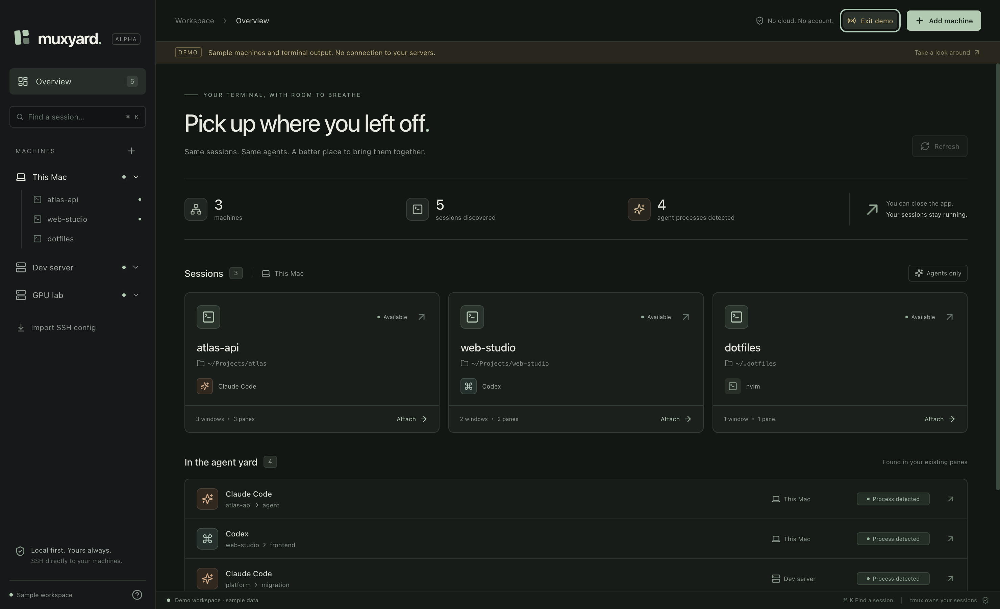
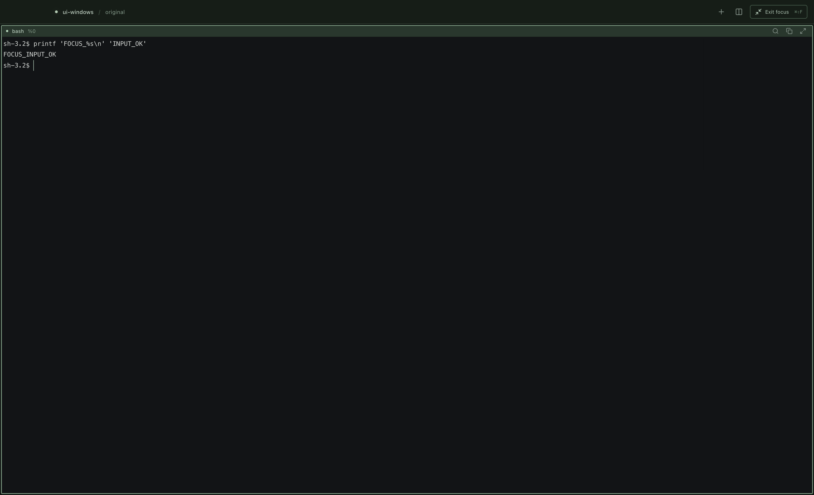

# Muxyard

**Your tmux sessions. A little more civilized.**

A desktop GUI for the tmux sessions and coding agents you already run — locally or over SSH. Connect to a machine, discover its existing sessions, and pick up exactly where you left off.

No account. No cloud relay. No remote Muxyard daemon. Just your computer, OpenSSH, and tmux.



> Early working prototype. Local tmux attachment is covered by integration and desktop UI tests. Remote SSH support is implemented but still needs validation against real remote machines. No signed or notarized release is available yet.

## What works

- Discover existing sessions, windows, and panes on your computer or an SSH host.
- Create and attach a session directly from a machine’s **Sessions** heading, even when tmux is not running yet.
- Attach multiple sessions in terminal tabs, with full terminal input and output.
- Create tmux windows with **Ctrl+T**, **Cmd+T**, or the **New window** button, then switch them in the dedicated window tab bar.
- Display tmux splits as separate GUI terminal panels, with immediate mouse focus and input routed by pane ID.
- Click to select a window or pane. Split side by side or top and bottom, or toggle pane zoom.
- Search terminal scrollback with **Cmd+F** and copy selected text with **Cmd+C**.
- Find sessions with **Cmd+K**.
- Detect Claude Code, Codex, OpenCode, Gemini, and Aider when tmux reports their executable names.
- Preview and selectively import `Host` aliases from `~/.ssh/config`, with optional connection checks.
- Connect to named tmux sockets, including additional local socket profiles.
- Detach the app's client while keeping the underlying tmux session running.
- Explore a clearly labeled demo without connecting to a machine.
- Work in a compact terminal-first layout, with collapsible navigation and a focus mode.
- Choose five light/dark themes, follow system appearance, and customize accent and terminal colors without reconnecting.

Tmux remains responsible for persistence and process lifetime. Muxyard never migrates an existing agent, restarts its process, or detaches other clients with `attach -d`.

## Run on your Mac

Requirements: macOS, Node.js 22.12+ (or a newer supported release), npm, Xcode Command Line Tools, and tmux. Electron downloads its runtime during installation. Native PTY dependencies may require a compiler.

```sh
brew install tmux
npm install
npm run dev
```

Start a session in Terminal if you do not already have one:

```sh
tmux new -s my-project
```

Open Muxyard and select **This Mac**. Click a session card to attach. The **Detach** button closes only Muxyard's client. Closing the app also releases its clients.

To run a production build:

```sh
npm run build
npm start
```

To create a macOS app bundle for local testing:

```sh
npm run dist:mac
```

The app is written under `release/`. To create a DMG and ZIP for your Mac:

```sh
npm run dist:mac:installers
```

GitHub Actions configurations build macOS arm64/x64, Windows x64 (`.exe`), and Linux x64 (`.AppImage`, `.deb`) packages. A pushed version tag creates a **draft prerelease** with installers and checksums; it never publishes automatically. Windows currently supports remote tmux over SSH; local tmux and WSL integration are not implemented. Linux packages initially target Ubuntu 24.04.

Mac builds currently use ad-hoc signing; Developer ID signing, notarization, Windows signing, and automatic updates are not configured. See the [release guide](docs/releasing.md) for local commands, version tags, draft review, platform requirements, and signing.

## Connect to a remote host

Configure and verify the connection using system OpenSSH first (omit the macOS-only `UseKeychain` option on Linux/Windows):

```sshconfig
Host dev-server
    HostName server.example.com
    User developer
    IdentityFile ~/.ssh/id_ed25519
    AddKeysToAgent yes
    UseKeychain yes
    # Optional:
    # Port 2222
    # ProxyJump bastion
```

```sh
ssh dev-server
tmux ls
exit
ssh -o BatchMode=yes -o StrictHostKeyChecking=yes dev-server tmux -V
```

In Muxyard, choose **Import SSH config**, select the aliases you want, and click **Add selected machines**. Nothing is selected or contacted automatically. **Check & select reachable** tests the aliases matching the filter with at most three concurrent attempts, selects successful connections, and leaves failures unchecked. You can also use **Add machine** to enter `dev-server` manually.

Saved SSH machines connect only when chosen. Manually added and explicitly imported machines stay in **Machines** after restarting the app, even while offline. Older bulk-imported aliases remain in the collapsed **Other machines** list. Click their pin button to **Keep in Machines**, or connect successfully to promote them. Profiles and membership are stored in `hosts.json` inside Electron’s application-data directory, independently of transient connection snapshots. Successful connections refresh in the background; a failed connection stops polling until you explicitly choose it or refresh it again.

Key authentication must work without an interactive prompt. New host keys must be verified in Terminal first; Muxyard does not disable host key verification. Key paths, ports, and jump hosts are handled by OpenSSH configuration. Muxyard does not read or store private keys.

Tmux must be available on the remote non-interactive shell's `PATH`. No extra server software is installed. A remote named socket can be selected using the optional socket-name field (equivalent to `tmux -L name`). Custom socket filesystem paths (`-S`) are not supported yet.

The import button reads literal aliases in the main `~/.ssh/config` file. It skips wildcard patterns and does not expand `Include` files. Manually added aliases still use the full OpenSSH configuration, including `Include` and `ProxyJump`.

## Make it yours

Open **Appearance** using the palette button in the overview, attached workspace, or focus toolbar. Changes apply immediately to the interface and every existing terminal, including hidden windows. Switching colors preserves the connection, input, and scrollback.

| Theme    | Appearance | Character                                                 |
| -------- | ---------- | --------------------------------------------------------- |
| Daylight | Light      | Crisp whites, slate text, and a clear blue accent         |
| Paper    | Light      | Warm ivory, ink text, and a terracotta accent             |
| Graphite | Dark       | Neutral charcoal with cool blue highlights                |
| Dusk     | Dark       | Deep violet with a soft lavender accent                   |
| Grove    | Dark       | The original forest palette with stronger readable labels |

**Follow system appearance** is enabled by default: system light mode uses Daylight and dark mode uses Graphite. Choosing a palette fixes it until you enable system appearance again. Each palette remembers its own custom accent, terminal background, and terminal text colors. **Reset colors** restores the current palette; **Restore defaults** clears all overrides and follows the system again. Preferences survive app restarts.


Foreground colors are adjusted for readable contrast, including terminal ANSI colors. Programs that send explicit RGB colors or change their own palette retain that behavior; an app theme cannot automatically retheme every remote TUI. No terminal process is restarted or sent a theme command.

## Behavior to know

**Sessions, windows, and panes stay distinct.** The top tab bar switches attached sessions. The **WINDOWS** row switches tmux windows inside the selected session; each window has its own panes. New windows inherit the selected pane's working directory and are created on the same host, socket, and session. Their processes keep running when you switch windows or detach Muxyard. Window creation and navigation work in both Pane view and Classic terminal. External window creation, renaming, and removal are reflected in the tabs, with control-mode updates in Pane view and discovery polling in Classic terminal.

Attach an existing session before creating a window. These shortcuts apply to the attached workspace and do not run inside dialogs or text-entry forms:

| Action                          | Shortcut                    |
| ------------------------------- | --------------------------- |
| New tmux window                 | Ctrl+T or Cmd+T             |
| Next window                     | Ctrl+Tab                    |
| Previous window                 | Ctrl+Shift+Tab              |
| Split into left and right panes | Cmd+D                       |
| Split into top and bottom panes | Cmd+Shift+D                 |
| Toggle focus mode               | Cmd+Shift+F or Ctrl+Shift+F |
| Toggle machines sidebar         | Cmd+B                       |
| Toggle pane list                | Cmd+Shift+B                 |

Plain Ctrl+D continues to reach the terminal program. Pane view also supports the tmux prefix sequences **Ctrl+B c** (new window), **Ctrl+B n/p** (next/previous window), **Ctrl+B %** (left/right split), **Ctrl+B "** (top/bottom split), and **Ctrl+B z** (zoom).

**The terminal gets the workspace.** Attached sessions default to a compact toolbar and window tabs. The machines sidebar and pane inspector start collapsed, the overview header and repeated status/help rows are hidden, and a single attached session does not consume a separate session-tab row. Use the panel buttons or Cmd+B / Cmd+Shift+B to reveal navigation when needed. **Cmd+K** also reveals the machines sidebar and focuses session search.

**Focus mode maximizes terminal space.** Click **Focus** or press Cmd+Shift+F / Ctrl+Shift+F to hide both side panels and session tabs. A single compact title strip keeps clickable, horizontally scrolling **window tabs**, the session name, new-window and split actions, and **Exit focus** accessible. You can switch windows with the mouse without leaving focus mode. Window and pane shortcuts still work. Exit using the same shortcut or the visible button; plain Escape remains available to terminal programs. Your previous panel choices return when leaving focus mode. Layout preferences are saved locally, and the overview retains its full management interface.

Layout changes resize the existing terminal client rather than reconnecting it. This applies to both Pane view and Classic terminal; underlying tmux processes remain running.



**Existing tmux state is shared.** Selecting a window or pane can change what other clients of the same session see. An attached terminal can also affect tmux's layout sizing according to your configuration. Muxyard does not create grouped sessions or change global tmux options.

**Pane view is the default.** Each pane has its own terminal surface, focus outline, scrollback, search, and copy controls. Click directly in a pane to focus it; typing is addressed to that pane without waiting for tmux selection to round-trip over SSH. Existing horizontal and vertical splits, including splits made by another tmux client, are reflected in the GUI. Panels remain inside the same application window; detachable macOS windows are not implemented.

**Choose the right terminal mode.** Pane view uses tmux control mode and implements the common window, split, and zoom prefix sequences listed above. It restores the visible screen and up to 1,000 recent history lines at attachment, then streams live application bytes. It does not implement tmux's entire prefix-key table, tmux copy/choose overlays, or every historical terminal mode. Use **Classic terminal** for custom tmux bindings or a TUI that does not render correctly in pane view. Switching views leaves the underlying session running.

**Mouse behavior is local to each view.** Pane view focus works without changing your tmux mouse configuration. Classic terminal follows your existing tmux configuration; use `set -g mouse on` yourself if you want direct pane clicks there. Hold **Shift** while dragging to select terminal text when an application is using mouse reporting.

**Agent discovery is conservative.** `pane_current_command` is used to recognize agent executables. A wrapper reporting `node` or `python` may not be detected. The UI says “Process detected”; it does not claim to know whether an agent is working, finished, or waiting for permission. Agent hooks are a planned integration.

**Disconnects need a reattach.** Network failures leave the server's tmux sessions running under normal tmux configuration. Use **Reattach** after connectivity returns. Automatic reconnect and macOS sleep/wake recovery are planned. User-configured tmux options such as `destroy-unattached` can change session lifetime.

**Cached data can be stale.** Connected-host discovery refreshes every eight seconds, while attached pane layouts update from control-mode notifications. Failed hosts retain their last successful snapshot with a stale indication and wait for an explicit retry.

## Development

```sh
npm run typecheck
npm test
npm run test:integration
npm run build
npm run test:ui
```

Integration and desktop tests create uniquely named tmux sockets, then delete only their own test servers. They require tmux and permission to create PTYs and launch Electron. UI tests use an isolated application-data directory. Test screenshots are written to the system temporary directory.

The same UI checks can run against a packaged Apple Silicon app:

```sh
MUXYARD_APP="$PWD/release/mac-arm64/Muxyard.app/Contents/MacOS/Muxyard" npm run test:ui
```

The application icon is generated from [the SVG source](assets/icon.svg). After changing it, run `npm run icon` before packaging.

See [architecture](docs/architecture.md), [product direction](docs/product.md), [website and GitHub positioning](docs/website.md), and [contributing](CONTRIBUTING.md).

## License

[MIT](LICENSE)
